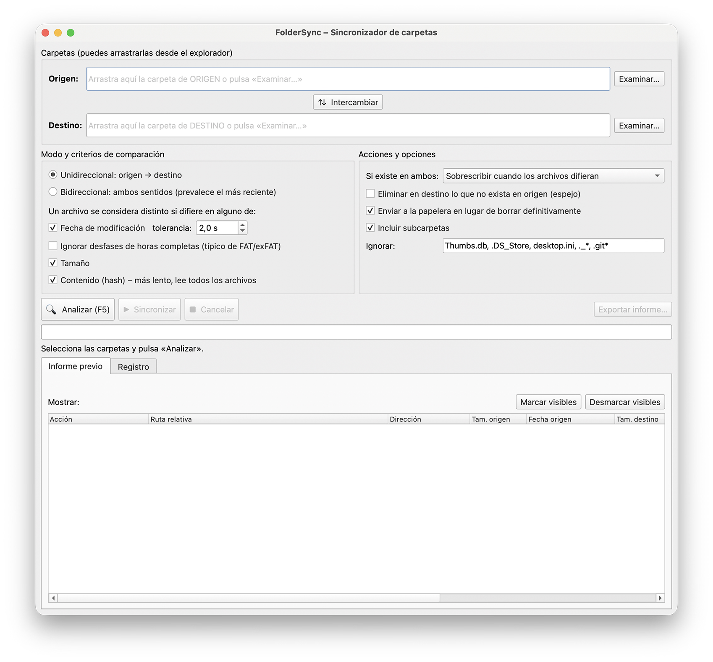
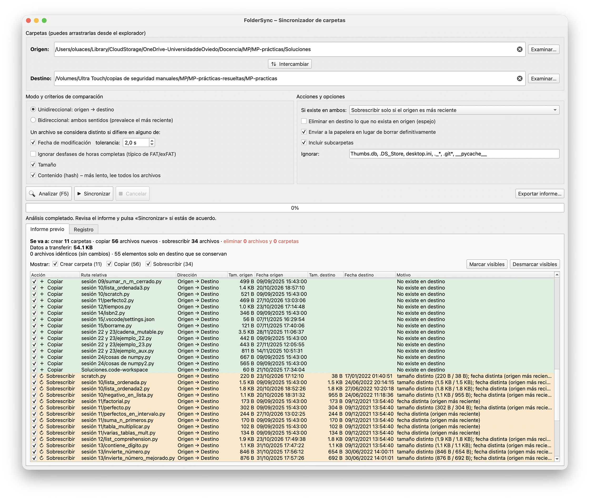

# FolderSync


> Desarrollado con la ayuda de [Claude](https://claude.ai) (Anthropic).

**FolderSync** es un sincronizador de carpetas con interfaz gráfica (PySide6) que **te enseña un informe detallado de lo que va a hacer antes de tocar ningún archivo**. Tú decides, operación por operación, qué se ejecuta.

<!-- Añade aquí una captura de pantalla:  -->




## Características

- **Drag & drop** de las carpetas de origen y destino (o botón «Examinar…»), y botón para intercambiarlas.
- **Dos modos**
  - *Unidireccional*: origen → destino, con opción de modo espejo (eliminar en destino lo que no exista en origen).
  - *Bidireccional*: se copia en ambos sentidos y prevalece el archivo más reciente.
- **Criterios de comparación combinables**: fecha de modificación (con tolerancia), tamaño y contenido (hash).
- **Política de sobrescritura** configurable, subcarpetas opcionales y patrones a ignorar.
- **Informe previo detallado** con una fila por operación, motivo, dirección, y tamaños y fechas de ambos lados. Puedes marcar o desmarcar operaciones una a una, filtrarlas por tipo y exportar el informe a un `.txt`.
- **Seguro por diseño**
  - Nada se ejecuta sin analizar y confirmar. Si cambias cualquier opción, hay que volver a analizar.
  - Las copias se hacen a un archivo temporal que se renombra al terminar, así que un fallo o una cancelación nunca dejan un archivo de destino corrupto.
  - Las eliminaciones pueden enviarse a la papelera.
  - Se rechazan carpetas iguales o anidadas una dentro de otra.
- **Análisis y sincronización en hilos**, con barra de progreso y botón de cancelar.
- **Pensado para unidades externas y macOS**: ignora diferencias de nombre por codificación Unicode (NFC/NFD) y desfases de horas completas típicos de FAT/exFAT.
- Recuerda tu configuración entre sesiones.

## Requisitos

- Python 3.9 o superior
- [PySide6](https://pypi.org/project/PySide6/)

## Instalación y uso

```bash
git clone https://github.com/<tu-usuario>/foldersync.git
cd foldersync
pip install -r requirements.txt
python folder_sync.py
```

O, si tienes `make`, en un entorno virtual aislado (`.venv`):

```bash
make run
```

Flujo de trabajo:

1. Arrastra (o selecciona) la carpeta de **origen** y la de **destino**.
2. Elige el modo, los criterios de comparación y las opciones.
3. Pulsa **Analizar** (`F5`) y revisa el informe.
4. Desmarca lo que no quieras hacer y pulsa **Sincronizar**.

## Tipos de operación del informe

| Acción | Significado |
|---|---|
| Crear carpeta | La carpeta no existe en el otro lado |
| Copiar | El archivo no existe en el otro lado |
| Sobrescribir | El archivo existe en ambos lados pero difiere según los criterios |
| Eliminar archivo / carpeta | Solo existe en destino y está activado el modo espejo |
| Conflicto | No se puede decidir qué hacer (p. ej., archivos distintos con la misma fecha en modo bidireccional, o una carpeta frente a un archivo). **No se toca** |
| Omitido | Los archivos difieren, pero la política elegida impide sobrescribirlos. **No se toca** |

Los archivos idénticos no se listan; solo aparecen contados en el resumen.

## Opciones

### Criterios de comparación

Un archivo se considera distinto si difiere en **alguno** de los criterios marcados:

- **Fecha de modificación**, con una tolerancia en segundos (2 s por defecto, adecuada para FAT/exFAT).
- **Tamaño**.
- **Contenido (hash)**: más lento, porque lee los archivos completos. Solo se calcula cuando el resto de criterios no ha detectado ya una diferencia.
- **Ignorar desfases de horas completas**: una diferencia de fecha de exactamente 1, 2… horas (hasta 14) cuenta como igual. Es habitual con FAT/exFAT por la zona horaria y el horario de verano.

### Política de sobrescritura (si el archivo existe en ambos lados)

| Política | Comportamiento |
|---|---|
| Sobrescribir cuando difieran | Se sobrescribe el destino con el origen, aunque el destino sea más reciente (el informe lo avisa) |
| Solo si el origen es más reciente | Se respeta el destino si es igual de reciente o más |
| No sobrescribir nunca | Solo se copia lo que falta |

En modo bidireccional, las dos primeras equivalen a «prevalece el más reciente».

### Otras opciones

- **Eliminar en destino lo que no exista en origen** (modo espejo): solo en modo unidireccional. En bidireccional no está disponible, porque sin un historial de sincronizaciones no se puede saber si un archivo se borró o es nuevo.
- **Enviar a la papelera** en lugar de borrar definitivamente.
- **Incluir subcarpetas**.
- **Ignorar**: patrones tipo *glob* separados por comas, aplicados al nombre y a la ruta relativa. Por defecto: `Thumbs.db, .DS_Store, desktop.ini, ._*`.

## Notas y limitaciones

- Los **enlaces simbólicos** y los elementos especiales (sockets, dispositivos…) se ignoran y se anotan en la pestaña «Registro».
- Si una carpeta marcada para eliminar contiene elementos ignorados, no queda vacía y se **conserva**; se avisa en el registro.
- Una operación depende de que su carpeta padre exista. Si desmarcas «Crear carpeta» pero dejas marcados los archivos de su interior, la carpeta se crea igualmente al copiarlos.
- Las copias conservan la fecha de modificación y los permisos del archivo original.
- El informe refleja el estado de las carpetas en el momento del análisis. Si los archivos cambian después, vuelve a analizar.

Desarrollado y probado en **macOS** con discos exFAT. La lógica de comparación y sincronización también se ha probado en Linux. En Windows debería funcionar, pero no se ha probado a fondo.

## Configuración guardada

Las rutas, las opciones y el tamaño de la ventana se guardan con `QSettings` al cerrar la aplicación:

| Sistema | Ubicación |
|---|---|
| macOS | `~/Library/Preferences/` (archivo `.plist` de FolderSync) |
| Windows | Registro: `HKEY_CURRENT_USER\Software\FolderSync\FolderSync` |
| Linux | `~/.config/FolderSync/FolderSync.conf` |

Los informes no se guardan: hay que analizar de nuevo en cada sesión.

## Icono y empaquetado

El icono de la aplicación está dibujado en el propio código. Para generar los ficheros de imagen:

```bash
python folder_sync.py --export-icon icons
```

Esto crea PNG de varios tamaños y un `.ico`. El repositorio incluye además `icons/folder_sync.icns` (macOS), `icons/folder_sync.ico` (Windows) y `icons/folder_sync.png`.

## Crear una aplicación independiente

El `Makefile` detecta el sistema y empaqueta la aplicación con [PyInstaller](https://pyinstaller.org/) dentro de un entorno virtual propio:

```bash
make build     # genera la aplicación para el sistema actual en dist/
```

| Sistema | Resultado |
|---|---|
| macOS | `dist/FolderSync.app` (y `make dmg` crea además `dist/FolderSync.dmg`) |
| Windows | `dist/FolderSync.exe` |
| Linux | `dist/FolderSync` |

Otros objetivos: `make venv`, `make run`, `make clean` y `make distclean` (borra también `.venv`). Ejecuta `make` sin argumentos para ver la ayuda.

Notas:

- La aplicación se empaqueta para el sistema en el que ejecutas `make build`; no hay compilación cruzada.
- En **Windows** necesitas GNU make y una shell tipo sh (por ejemplo Git Bash).
- En **macOS**, la aplicación no está firmada ni notarizada. Si Gatekeeper la bloquea al copiarla a otro equipo, ábrela con clic derecho → «Abrir», o ejecuta `xattr -cr FolderSync.app`.

## Estructura del proyecto

```
.
├── folder_sync.py      # Aplicación completa (modelo, análisis, hilos e interfaz)
├── requirements.txt    # Dependencias de ejecución
├── Makefile            # Ejecutar y empaquetar en macOS, Windows y Linux
├── icons/              # Iconos de la aplicación (.icns, .ico, .png)
├── .gitignore
└── README.md
```

## Licencia

Distribuido bajo la licencia MIT. Añade un archivo `LICENSE` con el texto completo antes de publicar.
